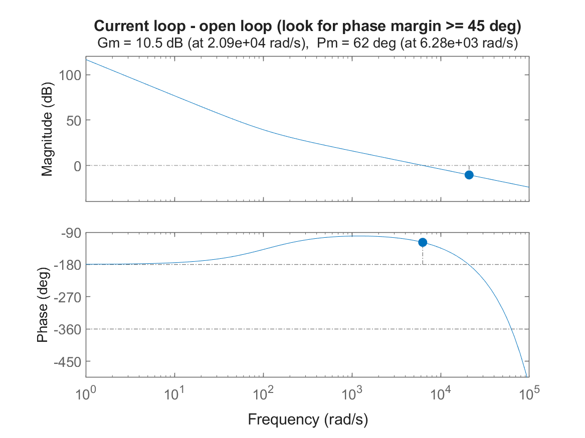
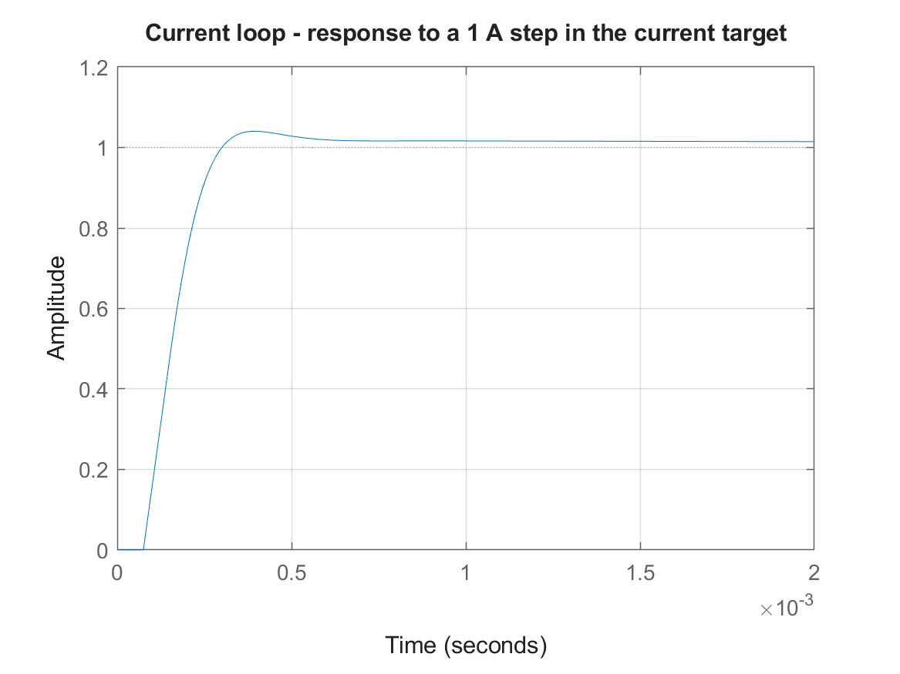
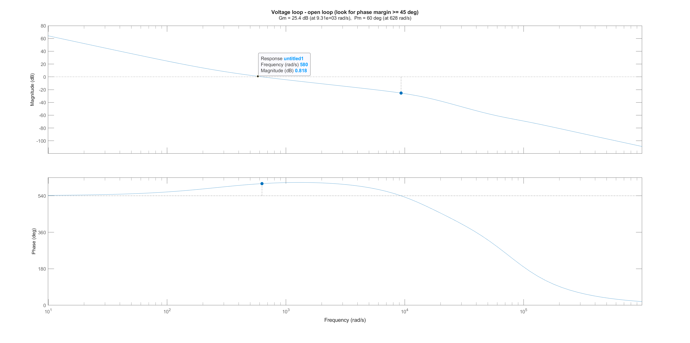
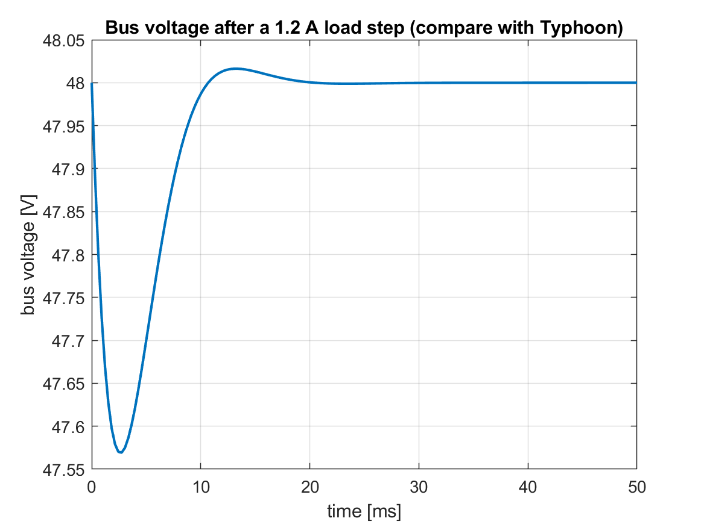

# Hybrid-Storage DC Microgrid: Controller Tuning

PI tuning for the battery + supercapacitor controller on a 48 V DC bus that emulates AI data center load swings. Part of the 7x24 Exchange University Challenge project at Manhattan University.

These are **simulation-based starting values**. They still have to be confirmed in the Typhoon HIL switching model and on the physical bench.

## What's in this repo

| File | What it does |
|---|---|
| `tune_pi.m` | MATLAB (needs Control System Toolbox). Tunes the three PI loops with `pidtune`, plots each loop, and saves everything to `results/` |
| `tune_pi.py` | The same method in Python (numpy only), for anyone without MATLAB |
| `results/pi_gains.csv` | The tuned gains, speeds and phase margins |
| `results/*.png` | Bode plots, the current-loop step response, and the bus dip on a load step |
| `results/command_window.txt` | The full printed output of the MATLAB run |

## The control structure

Cascade control: the voltage loop's output is the current loops' target.

| Loop | Controls | Target speed | Phase margin |
|---|---|---|---|
| Current loops (battery and supercap, same gains) | Inductor current | 1 kHz | 60° |
| Voltage loop | 48 V bus voltage | 100 Hz | 60° |
| Grid loop (rectifier stand-in, planned) | Bus voltage, slowly | 10 Hz | 45° |

## How the target speeds were chosen

**Current loop: limited by the controller's delay.** The C2000 measures once per switching cycle and its correction lands about 1.5 cycles later (75 µs at 20 kHz). With a 60° margin:

```
f_current = (90° − margin − PI lag) / (360° × delay)
          = (90 − 60 − 3) / (360 × 75 µs) ≈ 1 kHz
```

**Voltage loop: about 10× slower than the current loop**, so the current loop's response time costs the voltage loop only about 6° of margin:

```
f_voltage = f_current × tan(6°) ≈ 100 Hz
```

**Grid loop: about 10× below the storage's voltage loop**, so the grid ignores the fast swings the storage handles. Its 10 Hz voltage-sense filter costs 45° by itself, so the margin target is 45° rather than 60°.

## Model values and assumptions

| Quantity | Value |
|---|---|
| Bus voltage | 48 V |
| Storage voltage | 24 V (duty cycle 0.5) |
| Inductors | 1 mH |
| Bus capacitor | 3300 µF |
| Switching frequency | 20 kHz |
| Controller delay | 75 µs (estimate: 1.5 switching periods) |
| Load | 40 Ω ↔ 20 Ω (1.2 A ↔ 2.4 A); average 26.7 Ω |

## Limitations

- Averaged, linear models: no switching ripple, no current limits, ideal components.
- The 75 µs delay is an estimate and needs to be measured on the C2000.
- The 10 Hz rectifier speed for the grid loop is an assumption, not taken from a datasheet.

## Results

Exact values are in [`results/pi_gains.csv`](results/pi_gains.csv).

| | |
|---|---|
|  |  |
|  |  |

## How to run

- **MATLAB:** open `tune_pi.m` and press Run. Results are written to `results/`.
- **Python:** `python tune_pi.py` (needs numpy). Prints the gains and the bus dip.
